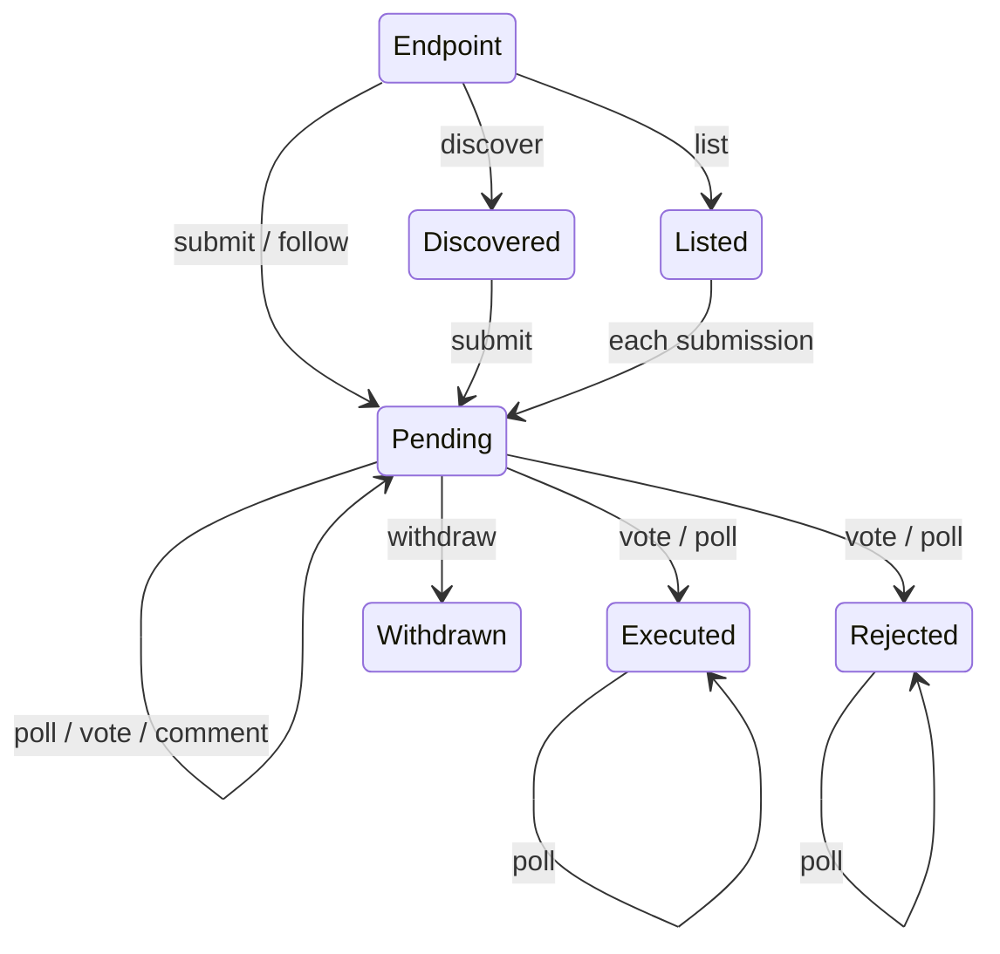

# States

Every answer from the client is a state. A state carries what the server said and offers only the moves that are valid in it. Check `kind`, and TypeScript narrows the state to the right one.

---

- [cS1 Discovered](discovered.md)
- [cS2 Listed](listed.md)
- [cS3 Pending](pending.md)
- [cS4 Executed](executed.md)
- [cS5 Rejected](rejected.md)
- [cS6 Withdrawn](withdrawn.md)
- [cS7 Refused](refused.md)

---

Any move can also lead to Refused. Withdrawn and Refused have no moves; start again from the endpoint.
